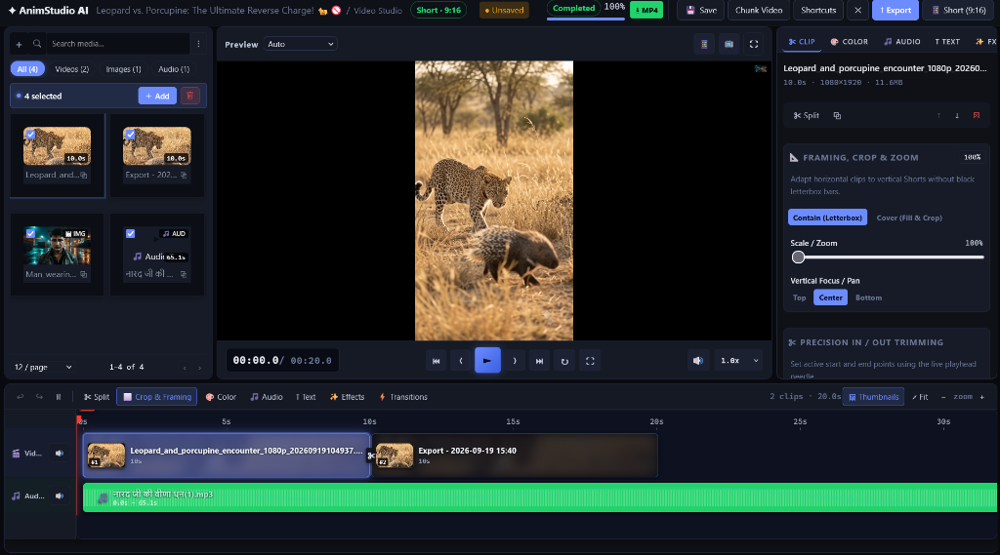
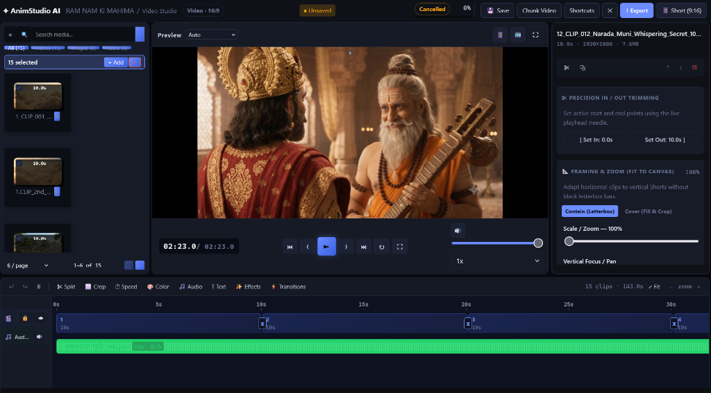
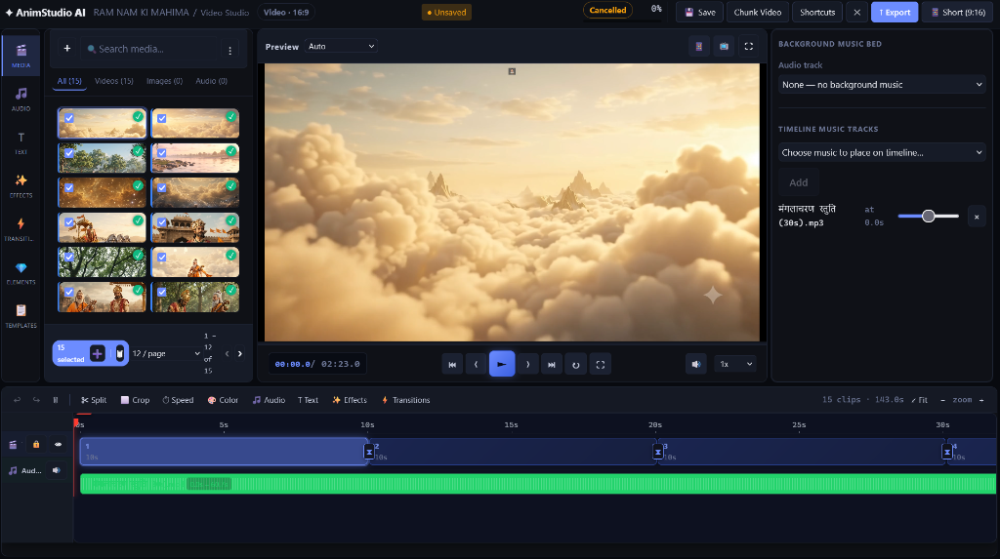
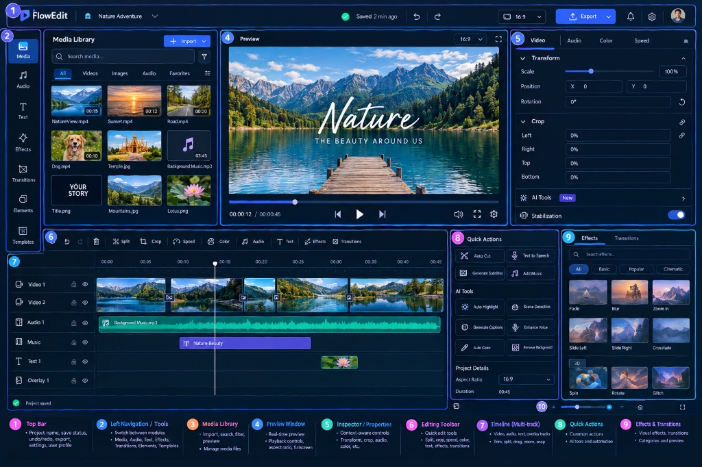
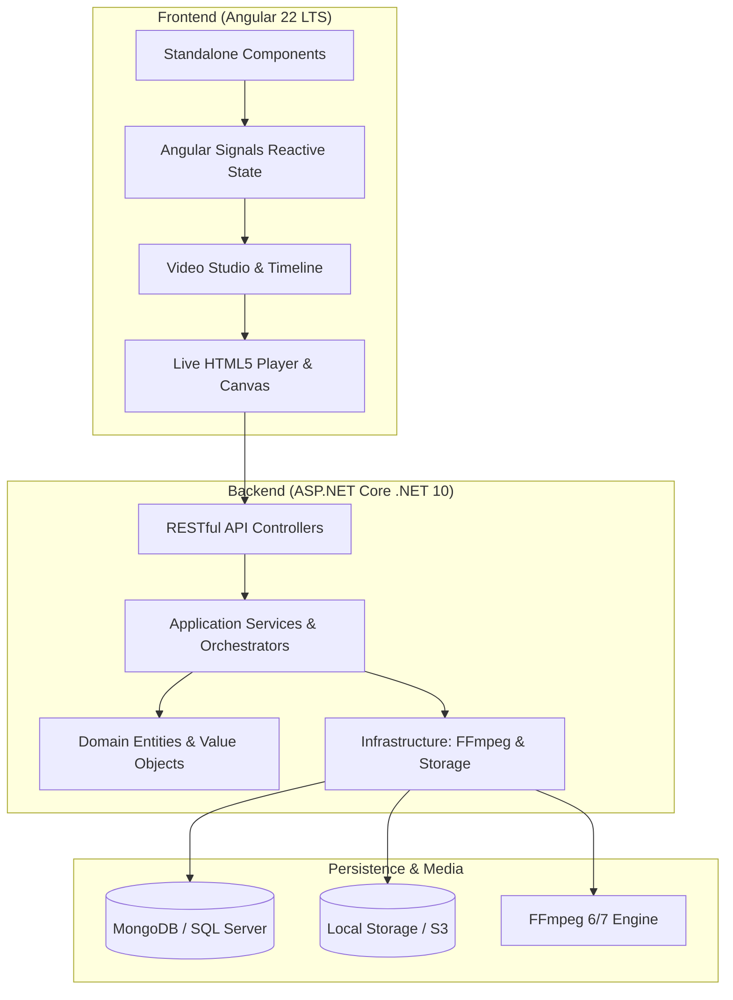

# 🎬 AnimStudio AI

<div align="center">

[](https://hacktoberfest.com/)
[](https://dotnet.microsoft.com/)
[](https://angular.dev/)
[](https://ffmpeg.org/)
[](LICENSE)
[](CONTRIBUTING.md)

**A modern, open-source AI-powered video creation studio & multi-track timeline editor.**  
Craft viral Shorts, Reels, YouTube videos, animated stories, and narrated slideshows with ease.

[Quick Start](#-quick-start) • [Features](#-key-features) • [Architecture](#-architecture--tech-stack) • [Setup Guide](docs/SETUP.md) • [Contributing](CONTRIBUTING.md) • [Roadmap](docs/ROADMAP.md)

</div>

---

## 📸 Screenshots

<div align="center">

### 📱 Vertical Studio (9:16 Shorts & Reels with Framing, Crop & Waveform Timeline)


<br/><br/>

### 🖥️ Widescreen Studio (16:9 Cinema Mode with Precision Trimming & Transitions)


<br/><br/>

### 🎵 Multi-Track Audio Engine & Timeline Music Cues


<br/><br/>

### 📐 Workspace Architectural Layout


</div>

---

## ✨ Key Features

### 🎞️ Video Studio 2.0
- **Multi-Track Timeline**: Synchronized video and audio tracks with playhead scrubbing, live waveform visualization, and thumbnail previews.
- **Mobile Workspace Panels**: On phones and tablets up to 900 px wide, switch between **Preview & timeline**, **Media library**, and **Inspector** without losing the open edit. Editor actions wrap onto additional rows instead of disappearing off-screen.
- **Precision Trimming & Splitting**: Split clips at playhead needle, trim In/Out points, duplicate clips, and arrange sequences effortlessly.
- **Seamless Live Transitions**: Real-time crossfades, directional slides, and wipe transitions with FFmpeg `xfade` integration.
- **Music-video transitions**: Blur-through, dip to black/white, iris-through-black and diagonal wipes join the existing zooms and reveals. In **Inspector > Transitions > Auto Transitions**, choose **Music video preset**, set **Apply to**, then **Apply** to cycle a varied pool across cuts. Preview scrubbing and the monitor share CSS approximations; export uses FFmpeg's native transitions. The preset does not select white flashes.
- **Reusable custom stingers**: Upload your own transition videos, transparent overlays, green-screen effects and sounds on **Effects**, then open the editor's **Effects** panel. **+ At cut** centres a transition or sound on the selected seam, or the nearest seam to the playhead; it refuses placement when there are no adjacent clips. Near either end, placement is shifted to fit where possible. Adjust the overlay timing if its coverage peak is not its midpoint. This places an overlay, not an arbitrary FFmpeg expression, and leaves the underlying transition unchanged.
- **Smart Aspect Ratio Switching**: Instant toggle between **16:9 (YouTube)**, **9:16 (Shorts/TikTok/Reels)**, **1:1 (Instagram)**, and **4:5** with automatic letterbox (Contain) or smart crop (Cover) scaling.

### 🎧 Audio & Sound Design
- **Background Music Bed**: Loopable ambient audio track with master volume control.
- **Timeline Music Cues**: Place multiple audio tracks at specific timestamps with independent volume sliders.
- **Intelligent Audio Ducking**: Automatically lower or mute video sound when a background music cue begins playing.

### Drive & Topics Library
- **Find and organise exports**: Search video titles, project names, and topics; filter portrait, landscape, square, or unknown formats across the entire library before pagination. Reset filters in one click.
- **Responsive browsing**: Eight layouts, touch-friendly controls, library counts, and a scrollable details table support phones, tablets, laptops, and ultrawide screens.
- **Accessible previews**: Keyboard-accessible thumbnails and titles open samples; the preview dialog keeps keyboard focus inside, closes with Escape, and returns focus to its opener.
- **Clear bulk actions**: Page selection shows partial selection. Select all matching items for bulk actions up to 200 videos; downloads explicitly target selected items on the current page.
- **Usage and deletion safety**: Downloads mark videos used. Auto-delete remains on by default, but downloads and marking used ask for confirmation before removing library records and sending Drive copies to trash. Turn it off under **Download & usage settings** to keep used videos. Archive and delete remain separate actions.
- **Transient failure recovery**: Library reads retry network/server failures twice with backoff, within a 60-second overall limit. If they still fail, previous results remain visible with actions disabled and a Retry button. Authentication/validation failures and state-changing operations are not automatically retried.

### Content Calendar
- **Responsive planning**: Agenda and progress views wrap on phones; the monthly calendar scrolls inside its own container so post labels and 44 px day/add controls remain usable. Topic and publish-day controls expose their selected states.
- **Reliable updates**: Refresh reloads both topics and posts. Topic-loading failures remain visible independently of successful post loads, and outdated requests cannot replace the current view. Ready actions prevent duplicate submissions.
- **Post controls**: Open posts with native title buttons. Keyboard activation of the separate Ready button no longer opens the post editor. New posts preserve a topic's midnight publish time.

### Themes
- **Light and dark**: Dark is the default. The **Dark/Light** switch in the top bar changes the theme, remembers it in that browser, and keeps open tabs in step. The saved choice is applied before first paint, so there is no flash of the wrong theme.
- **Token-based**: Colours live in `styles.css` as tokens keyed on `data-theme` (surfaces, text, borders, status colours, plus `--ov-*` translucent overlays and `--sunk-*` wells). New UI should use tokens instead of hard-coded colours; native controls follow the theme through `color-scheme`.
- **Dark by design**: The video editor and Camera Studio, and media preview frames (outro, subtitle and render previews) always use the dark palette, because preview and timeline colour accuracy matters there. Mark any new colour-critical surface with `data-theme="dark"`.

### Sign-in troubleshooting

- After signing in or switching accounts, the active page and its nested routed components are recreated, so a page such as the Drive library loads that account's data without a manual browser refresh. The URL, query parameters and fragment are kept; local page state and selections reset rather than carrying another account's state forward. Renewing a token or updating the same account's profile does not reset the page. The shell also refreshes access links and the Shorts badge.
- An **Active** account can still have a temporary password/2FA lockout. AnimStudio forwards Central SSO's HTTP 423 response; it does not disable the account itself.
- The password form requires the Central SSO password, not a device PIN or passkey. Choose **Sign in with Passkey** for the separate Central SSO flow. Existing sessions and passkey eligibility are governed by the identity service.
- Avoid repeated password attempts during a lockout. Wait for it to expire or use the identity portal's supported recovery options; ask an identity administrator to inspect lockout expiry and failed-sign-in audit events if it persists.
- `token.reuse_detected` is different from password lockout: the identity service received an already-rotated refresh token and revoked sessions. The identity proxy does not keep cookies in its pooled HTTP handler; it forwards each browser's cookie explicitly. Session-rotation POSTs are never automatically retried, and same-origin tabs serialize refreshes with Web Locks when supported. These safeguards do not bypass identity-service replay detection.
- On a matching production subdomain, the proxy preserves the shared SSO cookie domain and removes the legacy host-only copy. On localhost or an unrelated host it uses a host-only cookie. Previously created stale cookies may require signing in again after updating the API. Same-origin locks do not coordinate simultaneous refreshes from different portal origins.

### 📖 Story Agent (a title in, a narrated video out)
- **Just give a title**: Open **Story Agent** in the top bar. It searches the Granths (Wikisource), writes a Hindi or English script, makes the pictures, narration and music, builds an ordinary project, renders it, and prepares the YouTube title, description, tags and chapters.
- **Sources are checked, not trusted**: Every citation is checked against the shape of the text it names (an invented "Bhagavata Purana 13.2" is flagged), the chapters the writer was shown are marked *read*, and anything the texts don't say must be told as tradition ("it is believed"). You read and edit the script before anything is made, and nothing is published for you.
- **Works with no AI key**: A built-in Diwali story and "paste the script from any chat" (the app gives you the prompt, with the research already in it) need nothing configured. A text model, if you turn one on, writes it for you.
- **Your pictures, your voice**: Copy the picture prompts into Google Flow (or any image tool) and add the results to the scenes in one go. Narrate with a stock voice or your own consented voice; Hindi subtitles are drawn in an installed Devanagari font.
- **Characters with feelings**: The script writer gives every character's line an emotion (happy, laughing, angry, scared, surprised, sarcastic, whispering and more), and each character gets a voice of their own by gender and age. With Google Gemini TTS each line is spoken with its emotion; other engines ignore it. The scene's animation prompt (for Google Flow) asks for the matching face and, in the **Funny stories** genre or a playful scene, big cartoon reactions from the others: double-takes, jaw drops, eye-rolls. Change any line's feeling under **Who says what** in the script editor. Scripture stories keep a reverent set and are never played for laughs. Clips are still made in Google Flow and attached; the app does not generate video itself (see [P16](docs/plans/P16-animation-thumbnails-analytics.md)).
- **Automatic short-form styling**: Choose **Motion & transitions > Music video** before building, or **Music video** on the video's look review and rebuild. Scene moods guide zooms, blurred cuts, diagonal wipes and circular reveals, with variation even when moods repeat. Hand-pinned scenes keep their choices, moving clips get no extra camera motion, and Gentle/Automatic defaults remain unchanged. This is not beat detection or automatic extraction of effects from a reference video. Kaleidoscopic/spinning warps, decorative particles and lyric styling require your own effect media or the existing overlay, celebration and subtitle tools; a whole opaque reference video is not a reusable transparent transition.
- **Transition regression checks**: `npm --prefix frontend run test:transitions` checks all preview styles and custom cut placement without adding a browser test framework. Backend coverage is in `TransitionDurationTests` and `StoryLookTests`.
- **Safe to leave and come back**: A story keeps being made if you close the tab, resumes after a restart, retries from the step that failed, and only re-speaks a scene you edited.
- Setup, limits and the API: [docs/plans/P15-story-agent.md](docs/plans/P15-story-agent.md).

### 🎵 Music Release Kit
- **Distributor-Ready Master**: Two-pass loudness normalisation to -14 LUFS / -1 dBTP (or -16 / -11), 16- or 24-bit WAV at 44.1/48/96 kHz.
- **Artwork & Promo Videos**: 3000×3000 cover, a full-length 16:9 YouTube visualizer, and an 8-second 9:16 loop for Spotify Canvas, Reels and Shorts.
- **Release Sheet**: Metadata checked the way distributors check it (ISRC, UPC check digit, credits-in-title), exported as a copy-paste sheet and JSON. Upload the kit to the distributor of your choice; stores only accept releases through distributors.
- **Square Cover Crop & Remembered Details**: Crop a non-square cover yourself instead of a blind centre crop, and optionally keep artist, credits and label lines on your browser for the next release.
- **Go Live From the Kit**: Premiere the song (cover + live waveform) or its visualizer on YouTube Live in one click.

### 🔴 Go Live
- **Stream to YouTube Live without OBS**: The server is the encoder and sends over RTMPS. Streams run on the server, so closing the tab doesn't stop them.
- **Playlists From Anywhere**: Mix uploads, project renders, Clip Studio exports, project media, release kits and links (YouTube, Vimeo, Instagram, TikTok, X and more) in one stream. Reorder, rename, shuffle, and give songs a cover.
- **Prepare → Preview → Go Live**: Every item is converted to the exact stream format first, so you can watch each one, or the whole program, before anything is sent. Sending then just copies the files, so a 24/7 loop barely uses the CPU.
- **Saved Keys per Channel**: YouTube stream keys don't expire until reset, so admins save one per brand channel (encrypted, only ever shown masked). If YouTube refuses a key, the channel is flagged and you're asked to set it again. You can still paste a one-off key.
- **Resilient**: Automatic reconnect from the item that was playing, "go live again" without re-preparing, 720p or 1080p, landscape or vertical (Shorts feed).

### 📷 Camera Studio (live camera with identity protection)
- **Hide who you are**: On-device face tracking (MediaPipe, in the browser) covers every face with an animated character that copies your mouth, blinks and head tilt. You can pick one of 10 built-in characters, your project's own characters (they switch to the open-mouth image while you talk), your own image, an emoji, a block, pixelation or blur. Each person can get a different character.
- **Fails closed**: Until faces are tracked, while a face is briefly lost, or when a person is seen without a face (strict mode), the whole camera is covered. Go live is blocked until face tracking runs. Your real camera image never leaves your machine.
- **Design your own character**: Build one from parts (head, eyes, mouth, ears, hair, hat, glasses, colours) with a live preview that copies your face, then wear it on camera or use it as the corner mascot. Saved with presets.
- **A character that does what you do**: On-device body and hand tracking gives your character a body that copies your arms, hands and fingers (wave, thumbs-up, peace sign) and legs. Draw it over yourself, or replace yourself completely so no camera picture is shown at all. A corner mascot can idle, talk along with you, act out reactions, or copy every move you make.
- **Gestures**: Hand signs (thumbs up, peace, love-you, point up, open palm, fist, wave) and eye/face gestures (winks, closing both eyes, raised eyebrows, wide mouth, big smile, nod, head shake) trigger reactions (hearts, confetti, stars…), scene changes, snapshots, mute or the privacy card. Teach up to three of your own hand signs in 3 seconds each; they're matched on-device by k-nearest-neighbours on your hand's shape. Gestures can turn privacy and mute on, but never off. Hotkey G.
- **Brand overlays**: A scannable QR code card (links limited to http, https, mailto, tel, sms, upi and geo), a metallic authenticity seal with your own text, serial and date (a decorative design, not an official hallmark), and the corner mascot.
- **Body, background and voice**: Solid-silhouette, blurred or pixelated body; blurred, plain, animated or image background; voice changer (deep, high, robot, radio, alien) with noise suppression.
- **Overlays, each switchable**: LIVE badge with timer, people-on-camera count, name tags, live YouTube subscriber count with goal bar, live viewers, clock, name banner, scrolling ticker, watermark.
- **Show control**: Camera, screen, or screen plus camera in a corner; Starting soon (with countdown), Be right back, Ending and Privacy cards; hotkeys (1-5, P, F, M, G); auto-framing, looks and colour controls; presets with import/export; record to file; snapshot; pre-flight checklist and stream health.
- Subscriber and viewer counts need a YouTube Data API key on the server: `dotnet user-secrets set "YouTube:ApiKey" "…"` (or the `YouTube__ApiKey` env var / Key Vault). The face, body and hand models are fetched by `npm run vision:models` (runs automatically before `npm start` / `npm run build`).

### 🤝 Collab Studio (record yourself with an existing video)
- **Five layouts**: Duet (side by side), Stacked (original on top, you below), React (you in a round or rounded bubble), Green screen (you cut out on-device and standing in front of the original, no green screen needed) and Stitch (a part of the original plays, then it's your turn).
- **Little to set up**: The layout is picked from the original's shape (a wide video is stacked for Shorts, a tall one goes side by side). Pick the part to use with Start/End, press Space, and recording stops by itself at the end. Countdown (off, 3, 5 or 10 s), the original dips while you talk, and settings are remembered.
- **Fix it after recording**: Each take keeps your raw camera recording, so you can change the layout, bubble position, crop, mirror, volumes or sync and rebuild the take without filming again. Sync is corrected automatically for how late you heard the original; nudge it by hand if needed.
- **Takes and layers**: Up to six takes to compare. Use a take as the new original to duet with yourself or add another layer.
- **From anywhere, to anywhere**: Use a video from your computer, any video in a project (or *🤝 Collab with this video* in the asset library), or a link brought in through Media Studio. Download the result, or save it to a project, where it's ready in the video editor. 9:16, 16:9 or 1:1 at 720p or 1080p.
- Everything is drawn and recorded in the browser; nothing leaves the machine until you save it. Saving to a project needs MP4 recording (Chrome or Edge); other browsers can still download WebM.

### 🎨 Color Grading & Effects
- **9 Cinematic LUT Filter Presets**: Natural, Cinematic Warm, Cool Sci-Fi, Vivid Pop, Golden Hour, Teal & Orange, Cyberpunk, Film Noir, and Faded 90s.
- **Text & Logo Watermarks**: Positionable text or logo watermarks (Top-Left, Top-Right, Bottom-Left, Bottom-Right, Center) with font and opacity controls.

### 🤖 AI Video Generation & Script Ingestion
- **Script Ingestion**: Paste raw script text, upload `.srt` / `.vtt` subtitles, or ingest YouTube video captions directly via `yt-dlp`.
- **Pluggable AI Providers**: Modular provider architecture supporting **Groq**, **OpenRouter**, **Ollama**, **Cloudflare AI**, **Hugging Face**, and **ComfyUI**.
- **Speech Synthesis (TTS)**: Support for local **Kokoro** and **Piper** voice synthesis models.
- **Automated Caption Segmentation**: Intelligent sentence boundary detection, word-level timestamps, and subtitle formatting.

### 🚀 High-Performance FFmpeg Rendering Engine
- **Hardware-Probed Filter Graphs**: Generates optimized FFmpeg filtergraphs supporting `libass` burned subtitles, `libx264` encoding, and Ken Burns motion.
- **Lease-Based Job Queue**: Robust background worker architecture designed for distributed video encoding jobs with auto-cleanup and failure recovery.

---

## 🏗️ Architecture & Tech Stack



| Layer | Technology |
| --- | --- |
| **Backend** | ASP.NET Core (.NET 10.0 Web API), C# 13, Minimal APIs + Controllers |
| **Persistence** | MongoDB (6.0+) or Microsoft SQL Server (2019+), EF Core / Dapper |
| **Media Processing** | FFmpeg (6.0+ or 7.0+ full build with `libass` & `libx264`), `yt-dlp` |
| **Frontend** | Angular 22, TypeScript 6, Tailwind CSS & Modern CSS Custom Properties |
| **State Management** | Angular Signals (`signal()`, `computed()`), Standalone Components |

---

## ⚡ Quick Start

### 1. Prerequisites
Ensure you have the following installed:
- [.NET 10 SDK](https://dotnet.microsoft.com/download/dotnet/10.0)
- [Node.js 22 LTS](https://nodejs.org/) & npm
- [FFmpeg 6.0+](https://ffmpeg.org/) *(ensure `ffmpeg` and `ffprobe` are on your PATH)*
- [MongoDB](https://www.mongodb.com/try/download/community) *(or local SQL Server)*

> 💡 **Tip for Windows users**: You can install everything with `winget`:
> ```powershell
> winget install Microsoft.DotNet.SDK.10 OpenJS.NodeJS.LTS Gyan.FFmpeg MongoDB.Server Git.Git
> ```
> See [docs/SETUP.md](docs/SETUP.md) for full Linux, macOS, and Windows instructions.

---

### 2. Run the Application

#### 🚀 Option A: One-Click Launcher (Windows)
Double-click `run.bat` in the repository root. It launches both backend and frontend in Windows Terminal with live logs.

#### 🛠️ Option B: Manual Terminal Launch

**Terminal 1 — Backend:**
```bash
cd backend/AnimStudio.Api
dotnet run
```
*API runs at `http://localhost:5000` (Swagger at `http://localhost:5000/swagger`).*

**Terminal 2 — Frontend:**
```bash
cd frontend
npm install
npm start
```
*Frontend runs at `http://localhost:4200`.*

---

## ⚙️ Configuration & Secrets

AnimStudio AI follows strict security practices. **No secrets or credentials are ever committed to configuration files.**

### Database Setup
To set your local MongoDB connection string:
```bash
cd backend/AnimStudio.Api
dotnet user-secrets set "Mongo:ConnectionString" "mongodb://localhost:27017"
```

Or for SQL Server:
```bash
dotnet user-secrets set "SqlServer:ConnectionString" "Server=localhost;Database=AnimStudioDb;Trusted_Connection=True;TrustServerCertificate=True;"
```

### AI Provider Keys (Optional)
AI keys can be added via User Secrets or through the built-in Admin Settings UI:
```bash
dotnet user-secrets set "Ai:Secrets:groq" "gsk_your_groq_api_key"
```

### Story Agent (Optional)
Nothing needs configuring: the built-in story and pasting a script from any chat work without a key. To let a model write the scripts, turn a text provider on under **Settings → AI providers** (`ollama`, `claude-code` and `copilot-cli` need no key). For narration run `scripts\setup-voiceover.ps1`; background music needs `Music:JamendoClientId`. The `StoryAgent` section of `appsettings.json` has the limits and the Wikisource politeness settings; see [docs/plans/P15-story-agent.md](docs/plans/P15-story-agent.md).

---

## 🤝 Contributing & Hacktoberfest

We love contributions! Whether you're fixing bugs, adding new audio/video filters, polishing UI components, or adding documentation:

1. Read our [Contributing Guide](CONTRIBUTING.md).
2. Check open issues labeled [`good first issue`](https://github.com/keshavsingh3197/Keshav-AnimStudio-AI/labels/good%20first%20issue) or [`hacktoberfest`](https://github.com/keshavsingh3197/Keshav-AnimStudio-AI/labels/hacktoberfest).
3. Fork, branch, code, and submit a PR!

---

## 🔒 Security

Security issues and vulnerabilities should be reported responsibly according to our [Security Policy](SECURITY.md). Please do not open public issues containing sensitive vulnerability details.

---

## 📄 License

This project is licensed under the [MIT License](LICENSE) — see the [LICENSE](LICENSE) file for details.

---

<div align="center">

Made with ❤️ by [Keshav Singh](https://github.com/keshavsingh3197) and open-source contributors.

⭐ **Star this repository if you find it helpful!**

</div>
